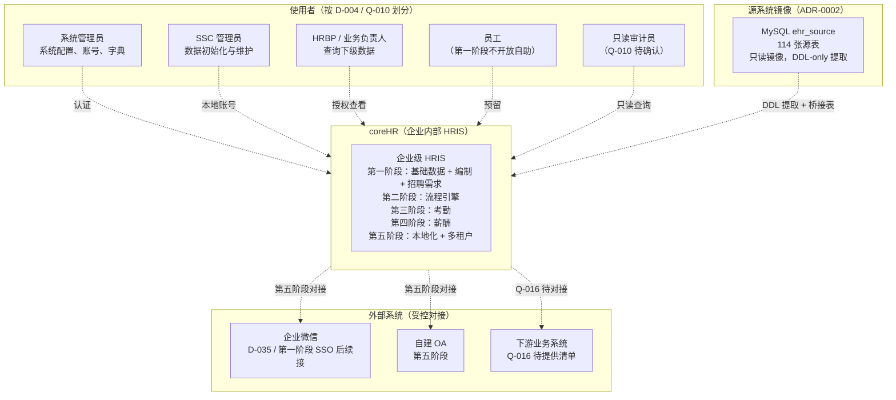
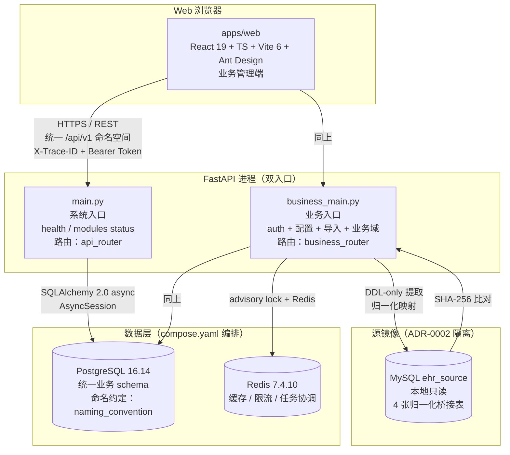
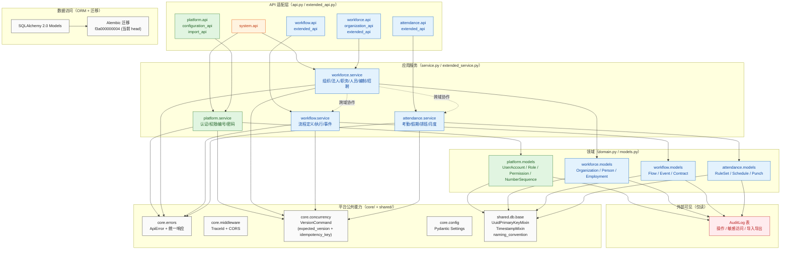
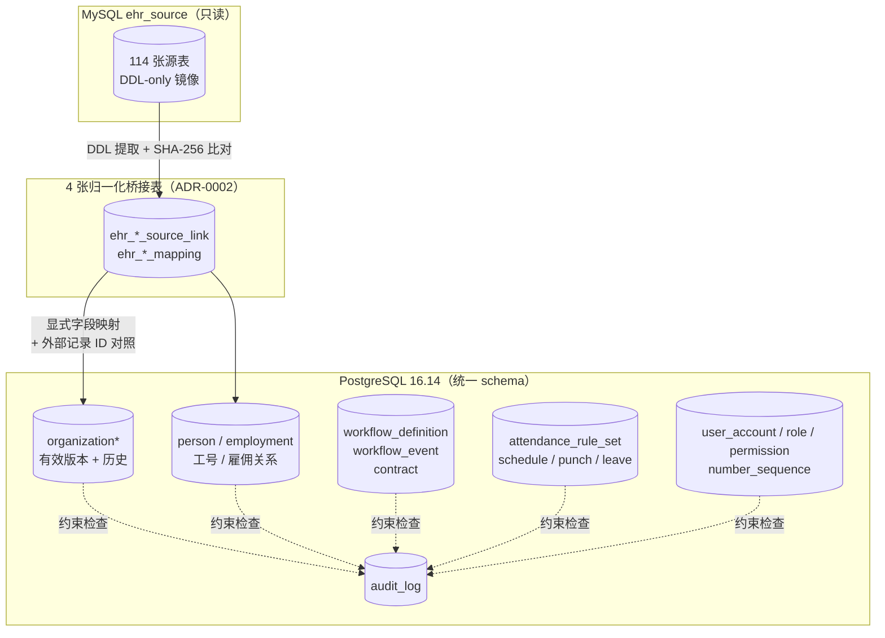
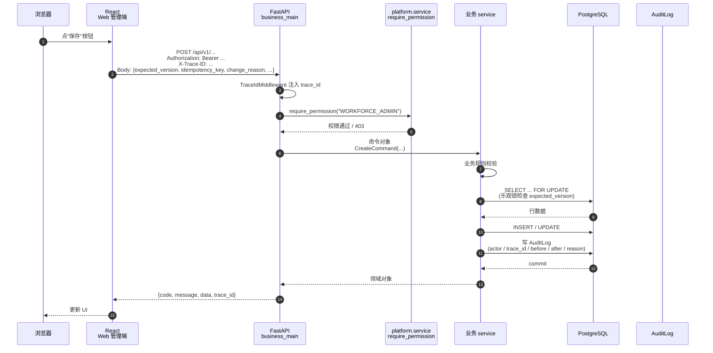
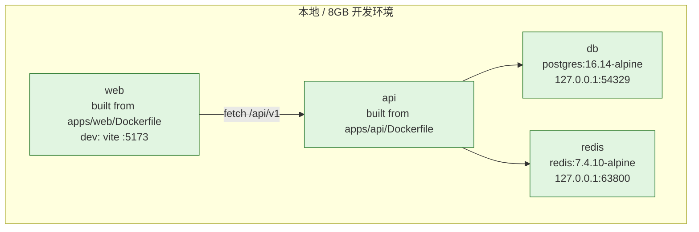

# coreHR 产品架构图

> 版本：v0.1 · 日期：2026-08-09 · 状态：基于当前 main `55369b6` 实际代码生成
>
> 依据：
> - 09 文档第 4 节模块边界
> - `apps/api/src/hris/`、`apps/web/src/`、`deploy/compose.yaml` 实际目录
> - 03-项目决策 D-001 ~ D-054
> - 10-代码规范 §3 §4 §5
>
> 描述方式：C4 模型（Context → Container → Module）

---

## 1. 系统上下文（System Context）

谁在用 coreHR，coreHR 跟谁对话。

**关键点**
- 第一阶段使用者**只**有系统管理员和 SSC 管理员（HRBP / 业务负责人 / 员工 / 审计员按 D-004 / Q-010 后续开放）
- 企业微信、OA、下游系统**前四阶段不接入**（D-035、09 文档 §4.2）
- EHR 源库**只作只读镜像**，不进入 coreHR 运行时（ADR-0002）

---

## 2. 容器图（Container）

运行时的物理 / 进程单元。

**关键点**
- **双 API 入口**：`main.py` 跑最小系统面，`business_main.py` 跑全部业务
- **PostgreSQL 是唯一业务库**：MySQL ehr_source 仅做只读桥接（ADR-0002）
- **Redis 用途收敛**：缓存、限流、任务协调；不存业务事实
- **Web → API**：HTTPS / REST / `/api/v1` 命名空间 / 统一 token / 统一 trace_id

---

## 3. 模块图（Module）

API 内部模块边界（基于 `apps/api/src/hris/modules/` 实际目录 + 代码规范 §4.2 依赖方向）。

**关键点（按代码规范 §4.2 依赖方向）**
- `api.py` 只做 HTTP 适配：接收输入、鉴权、调用 service、映射状态
- `service.py` 写业务规则、事务边界、幂等键
- `models.py` 持久化模型，**不**承载业务规则
- 跨模块协作只走 service 公开接口，**不**直接 import 对方 models
- 平台能力（errors / middleware / concurrency / db base）所有模块共享

---

## 4. 数据架构（Data）

**关键点**
- **唯一业务库**是 PostgreSQL 16.14（和 T-004 一致）
- **审计日志**是普通表，不是事件总线；不替代业务历史（08 文档 §10）
- **桥接表**是 EHR 接入的唯一路径，原表结构不进入 coreHR（ADR-0002）
- 所有表走 `naming_convention` 统一命名（base.py）

---

## 5. 关键流程：写操作路径

**关键点**
- 写操作必带三件套：**expected_version + idempotency_key + change_reason**（concurrency.py）
- 服务端鉴权（`require_permission`），前端隐藏按钮**不**代替权限
- 每次写自动写审计，trace_id 贯穿
- 错误统一格式 `{code, message, details, trace_id}`

---

## 6. 部署拓扑（compose.yaml）

**关键点**
- 端口只绑 `127.0.0.1`，不暴露外网
- 容器间通过 compose 网络用服务名互访
- `security_opt: no-new-privileges` 开启
- 启动用 `scripts/dev-business-up.sh`，停用 `scripts/dev-down.sh`

---

## 7. 不在本架构内（第五阶段 / 未确定）

| 项 | 状态 | 来源 |
|---|---|---|
| 多租户 | `DEFERRED` | 03-项目决策 D-008 |
| 多语言 | `DEFERRED` | 99-待确认问题 §3 |
| MCP 入口 | `DEFERRED` | T-007 |
| 移动端 | `DEFERRED` | 09 文档 §4.2 |
| 员工自助 | `DEFERRED` | D-006 |
| MySQL / Oracle 生产替换 | 第五阶段 | ADR-0002 |
| 企业微信正式身份 | 第一阶段后续 | T-006 |
| 一万人并发 | 第三、四阶段专项 | D-007 |

---

## 附录：图例

| 颜色 | 含义 |
|---|---|
| 绿 | 平台 / 公共能力 |
| 蓝 | 业务领域 |
| 橙 | 应用服务 |
| 紫 | API 适配层 |
| 灰 | 基础设施 / 跨切关注点 |
| 红 | 审计 / 不可变日志 |
